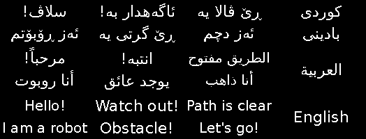

# ڕۆبۆتێ ئاخفتنێ (ESP32 Talking Robot)

ئەڤ ڕۆبۆتە ب **کوردیا بادینی**، **عەرەبی** و **ئینگلیزی** دئاخڤیت:
دەنگ ژ سپیکەری دهێت، و هەمان پەیڤ ل سەر شاشا OLED ژی دهێنە نڤیسین.
دوگمەیەک زمانی دگوهۆڕیت: کوردی ← عەرەبی ← ئینگلیزی.

The robot speaks Kurdish (Badini), Arabic and English through a DFPlayer Mini
and writes the same phrase on the OLED. A button cycles the language.



## پەیڤ (Phrases)

| فایل | کوردی | عەرەبی | English | کەنگی |
|---|---|---|---|---|
| 001.mp3 | سلاڤ! ئەز ڕۆبۆتم | مرحباً! أنا روبوت | Hello! I am a robot | دەمێ هەلدبیت |
| 002.mp3 | ئاگەهدار بە! ڕێ گرتی یە | انتبه! يوجد عائق | Watch out! Obstacle! | ئاستەنگ دبینیت |
| 003.mp3 | ڕێ ڤالا یە، ئەز دچم | الطريق مفتوح، أنا ذاهب | Path is clear, let's go! | ڕێ ڤالا دبیت |
| 004.mp3 | کوردی بادینی | العربية | English | دوگمە دهێتە پەستاندن |

## پێدڤی (Parts)

هەمی پارچێن `ESP32_Robot`، و ئەڤێن ل خوارێ ژی:

- DFPlayer Mini
- سپیکەر 3W یان کێمتر (4–8Ω)
- کارتا microSD (کێمتر ژ 32GB، FAT32)
- دوگمە (push button)
- ڕێزیستەرێ 1kΩ

## گرێدان (Wiring)

| پارچە | Pin | ESP32 |
|---|---|---|
| DFPlayer | VCC | 5V (VIN) |
| DFPlayer | GND | GND |
| DFPlayer | TX | GPIO16 |
| DFPlayer | RX | GPIO17 (ب ڕێزیستەرێ 1kΩ) |
| DFPlayer | SPK_1 / SPK_2 | سپیکەر |
| دوگمە | لایەک | GPIO4 |
| دوگمە | لایێ دی | GND |

OLED و IR و L298N وەکی `ESP32_Robot` دمینن.

## ئامادەکرنا دەنگان (MP3)

1. دەنگێن خۆ تۆمار بکە، بۆ نموونە ب ئەپێ *Voice Recorder* ل مۆبایلێ، و بکە MP3.
   بۆ عەرەبی و ئینگلیزی دشێی ماڵپەڕێن TTS ب کار بینی.
2. ل سەر کارتا microSD سێ بوخچان چێکە و فایلان ب ڤی ڕەنگی دانێ:

```
01/001.mp3   01/002.mp3   01/003.mp3   01/004.mp3   ← کوردی
02/001.mp3   02/002.mp3   02/003.mp3   02/004.mp3   ← عەرەبی
03/001.mp3   03/002.mp3   03/003.mp3   03/004.mp3   ← ئینگلیزی
```

ناڤێن بوخچان دڤێت دوو ژمارە بن (`01`) و ناڤێن فایلان سێ ژمارە (`001.mp3`).

## بارکرن (Upload)

1. ل Library Manager ئەڤ دوو کتێبخانە دابنێ:
   - **U8g2** (by oliver)
   - **DFRobotDFPlayerMini** (by DFRobot)
2. `ESP32_Talking_Robot.ino` ڤەکە. فایلا `texts.h` دڤێت د هەمان بوخچێ دا بیت.
3. **ESP32 Dev Module** هەلبژێرە و Upload بکە.

بۆ تاقیکرنێ بێی کو ڕۆبۆت بلڤیت، `USE_MOTORS` بکە `false`.

## گوهۆڕینا نڤیسینێن شاشێ

نڤیسینێن کوردی و عەرەبی وەکی وێنە ل `texts.h` هاتینە پاراستن، چونکی U8g2
نەشێت پیتێن عەرەبی پێکڤە گرێ بدەت و پیتێن کوردی (ڤ ێ ۆ ڕ ە) نیشان بدەت.
بۆ گوهۆڕینا وان، `TEXTS` ل `tools/make_texts.py` بگوهۆڕە و ل سەر کۆمپیوتەرێ لێ بدە:

```
python3 tools/make_texts.py
```

The OLED text is stored as pre-rendered bitmaps because U8g2 cannot shape
Arabic script; edit `tools/make_texts.py` and re-run it to change the phrases.
