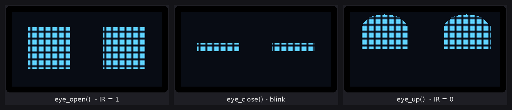
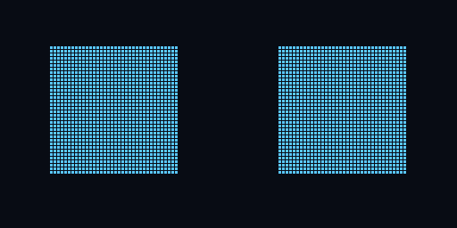
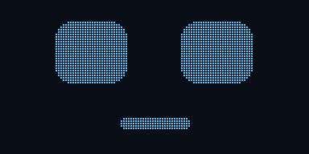

# ESP32_oled_ir
This repo is about getting started with ESP32.In this repo you will cover two topic sending and receiving data from ESP32.This repo is about receiving data from an IR sensor and  display robotics eyes on an OLED 128x64 display using ESP32.

WATCH FULL TUTORIAL VIDEO --> https://youtu.be/Oq6sax94xng

**ACT 1 COMPONENT SELECTION**

ESP32:There are many benefits for using ESP32 than Arduino Nano.It is much faster, has more memory, and has built-in Wifi and bluetooth.

OLED:For this project 128X64 OLED is selected.It has much more pixel than a normal 16x2 display, so it gives more room being creative with the diplay. 

IR SENSOR:The functionality of this IR sensor is that it help us to understand how data is sent to ESP32.If we take it further we can get creative with it.If the IR sensor receives zero it will look up otherwise it will continue to blink.

**ACT 2 WIRING**

The wiring diagram shows the pin configuration.The fritzing file and wiring diagram is uploaded in the repo.

**ACT 3 LOPAKA**

After wiring up the circuit it's time to design some animation without little to no effort (you dont need to code).Goto lopaka(https://lopaka.app/) set the libray to U8g2 and display to 128x 64 (you may set accordingly to your need).

Now be creative and start designing ENGINEERS!!! 

After designing copy the code.

**ACT 4 CODING**

We are almost there.Coding file is uploaded to this repo.Open your Arduino IDE and search for U8g2 (library by oliver).

Set up the U8g2 library.

Paste the code you have just copied into the loop function or you can make function and call that function into the loop function.

Select the board and Upload the code and you have done it ENGINEERS!!!!

**ROBOT EYES PREVIEW**

How the eyes from `OLED_IR_CODE.ino` look on the 128x64 OLED:

To regenerate the images: `python3 tools/render_eyes_preview.py` (needs Pillow).

**ESP32 ROBOT EYES (FULL CODE)**

`ESP32_Robot_Eyes/ESP32_Robot_Eyes.ino` is a complete, improved version of the sketch:

- Rounded robot eyes that blink at random times and look around (left, right, up, down).
- Smooth, non-blocking animation (~50 FPS, no `delay()` in the loop).
- When the IR sensor detects an object, the robot looks up and smiles; it goes back to normal shortly after the object leaves.
- IR input is debounced; status messages are printed to the Serial Monitor (115200 baud).

Wiring: OLED SDA -> GPIO21, SCL -> GPIO22, VCC -> 3V3, GND -> GND. IR sensor OUT -> GPIO34, VCC -> 3V3, GND -> GND.
Library: U8g2 by olikraus. Board: "ESP32 Dev Module".

**ESP32 TALKING ROBOT**

`ESP32_Robot_Talk/ESP32_Robot_Talk.ino` gives the robot a voice with a DFPlayer Mini MP3 module.
Record your own sentences (any language) as MP3 and put them on a FAT32 microSD card in a folder
named `mp3` (`mp3/0001.mp3`, `mp3/0002.mp3`, ...). The OLED shows eyes and a mouth that moves while
the robot talks.

- Sentence 1 at start-up, a random greeting (2-4) when the IR sensor sees someone, and a random
  sentence (5-6) when nobody has been around for 30-60 seconds.
- Type 1-9 in the Serial Monitor (115200 baud) to play a sentence.

Wiring: DFPlayer VCC -> 5V (VIN), GND -> GND, TX -> GPIO16, RX -> 1k resistor -> GPIO17,
BUSY -> GPIO4, SPK_1/SPK_2 -> speaker (3W, 4-8 ohm). OLED and IR as above.
Libraries: U8g2 and DFRobotDFPlayerMini.

