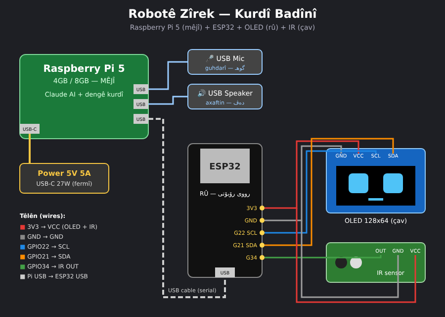

# رۆبۆتێ زیرەک — ب کوردیا بادینی دئاخڤیت 🤖



## کیژ ژ ڤان ٤ تشتان باشە؟

| # | تشت | بها | بڕیار |
|---|-----|-----|-------|
| 1 | Raspberry Pi 5 — 4GB | $81 | ✅ **باشترینە** — مێشکێ رۆبۆتی. ئەگەر دشێی **8GB** بکڕە (بۆ گوهداریا دەنگێ کوردی ل سەر Pi ب خۆ). |
| 2 | Raspberry Pi 3 B+ | $69 | ❌ **نەکڕە** — کەڤن و هێدیە، و بهایێ وێ نێزیکی Pi 5 ـە. |
| 3 | Acrylic Case بۆ Pi 4B | $2.60 | ⚠️ ئەڤ قاپە بۆ **Pi 4B** ـە، ل سەر **Pi 5** باش رێک ناکەڤیت. قاپێ تایبەت بۆ Pi 5 بکڕە. |
| 4 | ESP32 + OLED | — | ✅ **باشە** — دبیتە **رووێ** رۆبۆتی (چاڤ و دەڤ). |

> ئاگەهداری: Pi 5 و Pi 3 هەردوو "Out of stock" نە ل کورد ئێلێکترۆنیک.

## پێدڤی

- Raspberry Pi 5 (4GB یان 8GB) + power **5V 5A USB-C (27W)** + microSD 32GB
- ESP32 + OLED 128x64 (I2C) + IR sensor (ئەو یێن هەین)
- **USB Mic** و **USB Speaker** — Pi 5 جهێ 3.5mm audio نینە!
- کابلێ USB بۆ گرێدانا ESP32 ب Pi ڤە

## گرێدان (Wiring)

| ESP32 | OLED | IR |
|-------|------|----|
| 3V3 | VCC | VCC |
| GND | GND | GND |
| GPIO22 | SCL | — |
| GPIO21 | SDA | — |
| GPIO34 | — | OUT |

ESP32 ب کابلێ USB دگەل Raspberry Pi 5 گرێبدە.

## چاوا کار دکەت

```
مرۆڤ دئێت ← IR دبینیت ← ESP32 دبێژیت "PERSON" ← Pi دبێژیت "Silav! Ez Zîrek im"
تو پسیار دکەی ← Pi (Claude AI) ب بادینی بەرسڤێ ددەت ← Speaker دئاخڤیت ← OLED دەڤ دلڤینیت
```

- `robot_face/robot_face.ino` — بۆ ESP32 (Arduino IDE + کتێبخانا U8g2)
- `pi_brain/robot_brain.py` — بۆ Raspberry Pi 5

## دەستپێکرن ل سەر Pi

```bash
cd pi_brain
python3 -m venv venv && source venv/bin/activate
pip install -r requirements.txt
export ANTHROPIC_API_KEY=...          # ژ console.anthropic.com
python3 robot_brain.py                # پسیار ب کیبۆردی بنڤیسە
python3 robot_brain.py --asr mms      # ب دەنگی بئاخڤە (پێدڤی 8GB RAM)
```

## راستی (گرنگ)

- **مێشک** (Claude) کوردیا بادینی باش تێدگەهیت و دنڤیسیت — ئینتەرنێت پێدڤیە.
- **دەنگ** (Meta MMS-TTS Kurmancî) دەنگەکێ رۆبۆتیە، نە وەکی مرۆڤی، و تنێ پیتێن لاتینی دخوینیت (Silav, çawa yî).
- **گوهداری** (تێگەهشتنا دەنگێ بادینی) هێشتا لاوازە؛ ل سەر 4GB بۆ دەستپێکێ کیبۆردێ ب کار بینە.
